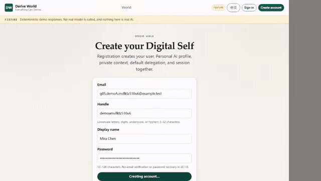
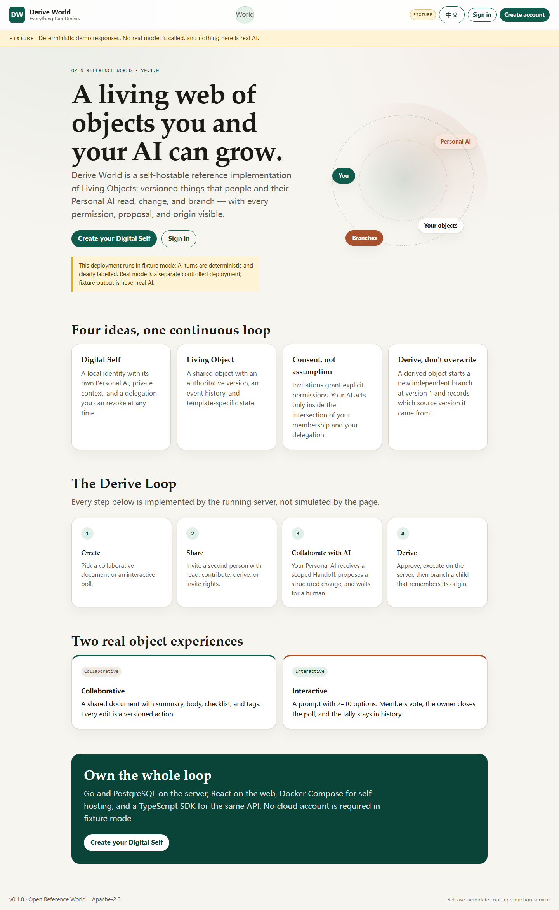
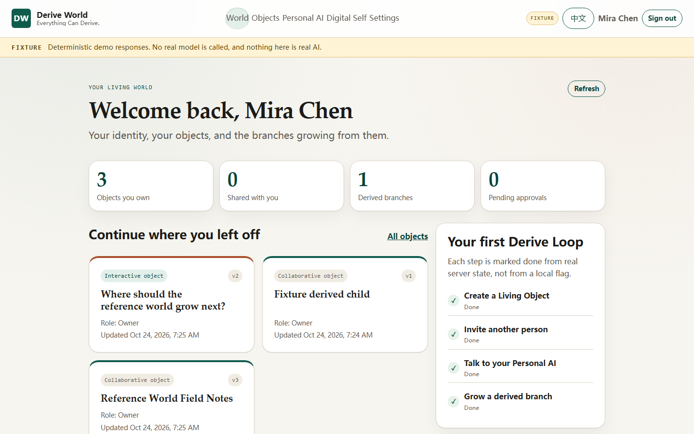

# Derive World

**Everything Can Derive. The First Living Web.**

Derive World is an open-source foundation for *Living Objects*: shared,
versioned objects that people and their personal AI can read, contribute to,
derive from, and trace through an explicit lineage. `v0.2.0` adds a World
Stage, living scenes, and free creation and derivation: the user
describes a world in their own words, the Personal AI writes a compact world
brief, and a server-side composer expands it into a real runnable world — a
time-based animation, a walkable space or playable game, a readable interactive
story, an operable workbench, a visual space, and a bounded declarative custom
surface for new forms. All surfaces share one content, state, variable,
permission, version and lineage model. A universal Personal AI, direct
friendship and messaging, opt-in public worlds, and public derivation remain.
Real-model acceptance is still a separate gate; fixture output is always
labelled demo data.

**Why it is different:** most AI tools treat chat as the product. Derive World
treats the *object* as the product: a Living Object has versions, members,
permissions, and a traceable lineage. A Personal AI can propose changes and
derive children, but only a human can approve; derived objects are independent,
not live pointers. The result is a small, auditable world you can run yourself.

## See it in action



A 17-second tour of the reference world: a Living Object, its version history
and lineage, and an interactive poll. The full recording is
[`demo-17s.webm`](docs/assets/demo-17s.webm). Fixture mode, no model API key.
[Showcase](SHOWCASE.md) has three launch examples and a voluntary way to share
what you build.

> **Status: released as `v0.2.0` (V2 product stage).** `v0.2.0` adds schema 11
> (36 tables): free-intent world creation, blank-world bootstrap, continuous
> natural-language modification, derivation, multi-form worlds (2D live,
> story, workspace, space, image/video, audio, 3D and a bounded custom
> surface), permission-scoped media, the V2 World Stage, friends and direct
> messages, opt-in publication and public derivation, and one universal
> Personal AI. **Real AI is verified only for the documented flows on DeepSeek
> `deepseek-flash`; the release makes no general provider claim. Fixture mode
> calls no model and is not real AI.** See
> [release notes](docs/en/release-notes.md) and [CHANGELOG](CHANGELOG.md).

## The Reference World

| | |
|---|---|
|  |  |

- **World** — a stage of your real objects and visible derivation branches,
  with a Living Pulse of real changes and pending human approvals.
- **Objects** — collaborative documents, interactive polls, living scenes
  (ideas, steps, scenes, choices, outcomes), and free worlds whose creator
  defines the kinds of things, their relations, and one-pass rules. A free
  world can compose its own experience from registered presentation and
  behavior capabilities, including uploaded images/video/audio, a GLB model
  or primitive 3D scene, sound cues and a simple physics world; the classic
  scene, stage, cards and timeline remain
  selectable views. Every type has versioned actions, members, invitations,
  Handoff, AI collaboration, a Derive Lens, history, and lineage.
- **Friends** — direct human friendship, messages, blocks, and object
  discussions. Friendship never grants object access by itself.
- **Explore** — opt-in public snapshots and derivation into an independent,
  private object when the owner allows it.
- **Personal AI** — one user-level AI that exists before the first world,
  keeps separate private conversations per world context, and can propose a
  real, human-approved first world. The Handoff preview never impersonates
  another user's AI.
- **Digital Self** — the consent ledger: delegations, revocation, and the human
  approvals that only you can give.
- **Settings** — language, tokens, export, runtime diagnostics, model
  connection check, deployment mode, and documented limits.

A two-user tour with expected results is in the
[Demo guide](docs/en/demo-guide.md). The full tour is in the
[Reference World guide](docs/en/reference-world.md).

## Two modes

| Mode | What it needs | What it proves |
|---|---|---|
| `fixture` | No model account or API key | Deterministic, repeatable UI and API behaviour. All AI output is labelled `FIXTURE`. |
| `real` | An OpenAI-compatible endpoint, model name, and API key | A real model call through `{MODEL_BASE_URL}/v1/chat/completions`. Costs are billed by your model provider. |

Fixture mode is a deterministic demo, **not** real AI. It must never be
presented as real model intelligence.

## Quick Start (Fixture, Docker Compose)

Requirements: Docker Engine with Compose v2, about 2 GB of free disk, and a
browser. This is the supported local path; the service binds to loopback only.

```bash
git clone https://github.com/QiyanAI/derive-world.git
cd derive-world
cp .env.example .env
docker compose up --build -d
docker compose ps
curl -fsS http://127.0.0.1:8080/readyz
```

The Compose build identifies as `0.2.0`; `DW_COMMIT` and `DW_BUILD_TIME`
remain `unknown` unless you set them. Release archives inject the tagged commit
and commit-derived build time.

Open <http://127.0.0.1:8080>. The top bar shows `FIXTURE` while the deterministic
adapter is active. Register a local account and you enter the World Stage:
create a project or story scene, edit its elements directly, open the Derive
Lens, invite a second person, publish a version to Explore, and inspect the
lineage. Friends can talk directly without going through Personal AI. The
`.env.example` values are development-only placeholders; they are not
production secrets.

### Windows: double-click launcher

On Windows, the self-hosting administrator can use the local launcher instead
of typing Compose commands:

1. Install and start Docker Desktop (with Compose v2).
2. Double-click **`Start Derive World.cmd`**.

The launcher checks Docker, the Docker Engine, Compose, port 8080, the
instance directory, `.env`, the database volume, and product health. It starts
the stack, waits for `/readyz`, and opens the browser. The same menu stops and
restarts with data preserved, opens and applies AI settings, and shows
diagnostics with secrets redacted. See
[launcher/README.md](launcher/README.md) and the
[Windows self-hosting guide](docs/en/windows.md). It opens no network listener,
passes no secret on a command line, and never deletes the database volume.
Other platforms keep the Compose path above.

### Who needs what

| Entry point | Needs Docker or a database? | What it can do |
|---|---|---|
| Public visitor | No | Browse Explore, read active public snapshots, and sign in to derive where the owner allows it. |
| Registered user on a reachable instance | No | Create and edit objects, use Personal AI, collaborate with friends, publish and derive. |
| Self-hosting administrator | Yes, for the supported Compose path | Run PostgreSQL, migrations, the Go service, the capability provider, and the web build. |

The Go server binary is **not** a standalone double-click desktop app: it needs
PostgreSQL, the embedded migrations to run, a built `WEB_DIST_DIR`, and a
configured provider for Real AI. A container image built once avoids repeated
compilation, but it does not remove the database requirement.

### Diagnostics

```bash
curl -fsS http://127.0.0.1:8080/healthz
curl -fsS http://127.0.0.1:8080/readyz
```

After signing in, **Settings → Runtime and limits** shows the model mode,
database and capability readiness, the public base URL, daily and hourly AI
limits, burst capacity, concurrency, and the deployment-wide stop. The same
non-secret facts are available at `GET /api/v1/system/status`.

For another device or another city, put the service behind HTTPS and set
`PUBLIC_BASE_URL` to that public origin. A `localhost` invitation link is only
valid on the machine that resolves it. The default Compose stack keeps the app
bound to `127.0.0.1`; do not expose it publicly without TLS, a reverse proxy,
and the security review in [docs/en/self-hosting.md](docs/en/self-hosting.md).

To stop the stack:

```bash
docker compose down
```

To stop and delete the local database volume:

```bash
docker compose down -v
```

## Browser acceptance

The blocking browser suite drives two independent users against the real
Compose stack: real PostgreSQL, the real Go API, and the production web build.
Chromium and Firefox each execute the complete Derive Loop; a 390 px mobile
project checks responsive and EN/ZH behaviour.

```bash
npm ci
npx playwright install --with-deps chromium firefox
npm run test:e2e
```

The CI job named **E2E** runs the Compose smokes, installs both browsers, runs
the suite, and uploads traces/screenshots. It is a required status check on
`main`; there is no bypass actor. `PW_REQUIRE_FIXTURE=1` fails closed if the
stack is not in fixture mode. Rate-limit overrides are applied only inside the
test `.env`; production defaults are unchanged.

## Real AI mode

Edit `.env` and set at least:

```text
MODEL_MODE=real
MODEL_BASE_URL=https://your-openai-compatible-host
MODEL_NAME=your-model
MODEL_API_KEY=your-key
```

`MODEL_BASE_URL` is a root address **without** `/v1`. The adapter appends
`/v1/chat/completions` exactly once, including when the value ends in `/` or
`/v1`. Then recreate the app container:

```bash
docker compose up -d --force-recreate app
curl -fsS http://127.0.0.1:8080/api/v1/meta
```

The response must report `"model_mode":"real"`. If required Real-mode settings
are missing, the process fails at startup instead of silently falling back to
Fixture. Real mode is a separate controlled operation. The approved two-call
real-AI acceptance run completed exactly two `deepseek-flash` calls: A used 764
input / 51 output tokens and B used 804 / 49. The estimated cost was
≈US$0.00030 off-peak (US$0.00059 peak upper bound), below the US$0.05 cap. The
API key was never written to the repository or evidence. A further real call
requires a new owner authorization; there is no automatic retry.

Model access is vendor-neutral: the business layer uses only the `Provider`
interface. `MODEL_CHAT_PATH`, `MODEL_RESPONSE_FORMAT`, and
`MODEL_THINKING_MODE` are optional adapter settings; the default request is the
generic OpenAI-compatible one. One adapter is active per deployment; concurrent
multi-provider routing is future versioned work, not a claim of this build.

Real deployments should also set the budget controls documented in
[Self-hosting](docs/en/self-hosting.md#model-budget-and-stop-controls):
`MODEL_MAX_INPUT_CHARS`, the per-user daily limits, the deployment-wide
`MODEL_GLOBAL_DAILY_CALLS` hard stop, and `MODEL_KILL_SWITCH`. Real mode forces
a positive global call cap even when the variable is unset or zero.

## Local development

```bash
npm ci
npm run -w web build
npm run -w sdk/typescript build
# Start a local PostgreSQL first, for example:
# docker run --rm -d --name dw-dev-db -p 5432:5432 #   -e POSTGRES_USER=derive -e POSTGRES_PASSWORD=dw_local_only #   -e POSTGRES_DB=derive_world postgres:17-alpine
cp .env.example .env
set -a; . ./.env; set +a
go run ./cmd/server migrate
go run ./cmd/server serve
```

The Go service serves `web/dist` at `/` and exposes the API under `/api/v1`.
The web dev server proxies `/api` to the Go service when you run
`npm run -w web dev`; because the browser origin is then
`http://localhost:5173`, start the Go service with
`PUBLIC_BASE_URL=http://localhost:5173` so the Origin/CSRF checks accept the
dev server. Integration tests require `DATABASE_URL` and run with
`go test -tags=integration ./tests/...`.

## Repository layout

```text
cmd/server/                 single service entrypoint
internal/                   modular-monolith packages
api/openapi/openapi.yaml    OpenAPI 3.1 contract
web/                        React 19 + Vite reference client
sdk/typescript/             ESM SDK with zero runtime dependencies
examples/capability-provider independent stdlib-only provider
examples/sdk-node/          dependency-free SDK example
tests/security/             real-PostgreSQL integration and negative tests
tests/e2e/                  Playwright config, specs, capture, curl smokes
docs/en, docs/zh            developer documentation and the Reference World tour
docs/assets/                real screenshots and two-user recordings
ops/github-metrics/         independent AI-OPS metrics module
```

The module dependency direction is one-way and enforced by the architecture
test: `app -> domain modules -> store`, with `httpx`, `config`, and `model`
depending only on the standard library (plus their frozen dependencies).

## Security defaults

- Bind address defaults to `127.0.0.1:8080`; Compose publishes only loopback.
- PostgreSQL and the reference capability provider are on internal networks.
- The `app` and `capability-provider` containers run as non-root (UID/GID
  10001) with a read-only root filesystem and dropped capabilities; the
  PostgreSQL container uses its standard image; the one-shot migration
  container runs the same built server image as the app.
- No production secrets are committed. `.env` is ignored.
- CSP, nosniff, no-referrer, and Permissions-Policy headers are set by the app.
- Object content is untrusted. The server never treats model text or object
  content as an instruction; only schema-valid actions enter the proposal path.
- Object access is checked against active membership rows on every request; a
  caller without `read` receives 404, not 403. An open workspace transitions to
  access-lost on the next server read after revocation.
- Personal AI effective permission is membership ∩ active delegation ∩
  constraints. AI output never authorizes itself. Derive requires a separate
  five-minute, single-use human confirmation bound to an object version.
- Confirmations expose a bounded effect summary and are redacted after the
  caller loses read access to the target object.
- Invitation and PAT plaintext is returned once; only SHA-256 digests are
  stored. Invitation replays are redacted.
- Handoff projections are read-only, never credentials, and never include
  private context, conversations, tokens, or other members' delegations.
- Cookie writes require a session-bound CSRF token and a same-origin
  `Origin`/`Referer`. Login and registration reject cross-site requests.
- State changes require `expected_version`; conflicts never overwrite silently.
- Audit rows share the business transaction; an audit failure rolls the write
  back.
- Derive never modifies the parent and never inherits members, shared context,
  votes, or private data.
- Capability providers receive no cookies, PATs, private context, or database
  access. The Broker validates input and output schemas, enforces timeout and
  size limits, signs every outbound request, rejects metadata/link-local
  addresses always, and rejects private ranges unless the provider is
  explicitly internal.
- The `http_hmac_v2` transport verifies a signed response bound to the request
  timestamp, invocation id, status, and body hash. An unsigned, tampered,
  replayed, or wrong-key response is an unknown result and its output is never
  stored. Public providers must use v2 over verified TLS; private CAs and
  mutual TLS are supported. HMAC rotation accepts a previous key only before a
  configured RFC3339 deadline.
- Model calls have per-call input and output-token ceilings, per-user daily
  calls/characters, a deployment-wide daily call/character hard stop, and an
  operator kill switch. Quota refusals happen before the provider call, are
  audited, and survive a restart by reseeding from `model_invocations`. Each
  provider-attempted call writes a durable pre-call reservation to
  `model_invocations` before the request, so a crash, business rollback, or
  failed final update cannot hide a possible billable call.
- `timeout` and `unknown` capability results are never reported as success;
  unknown results never carry output.

Report vulnerabilities privately through GitHub Private Vulnerability
Reporting as described in [SECURITY.md](SECURITY.md): open the repository's
**Security** tab and choose **Report a vulnerability**. Do not open a public
issue.

## Limitations

- Single instance only; rate limiting and scheduling are in-process.
- No email, password reset, OAuth, or account deletion in `v0.2.0`.
- No simultaneous co-editing. The object workspace uses an authenticated SSE
  refresh signal with a polling fallback, and version conflicts are reported
  instead of silently overwriting. Public worlds, friends, and publications are
  scoped to one instance; there is no cross-instance federation.
- Public discovery and derivation are opt-in. Revoking a publication stops new
  reads and derivations but cannot delete copies that were already downloaded,
  screenshotted, cached, or independently derived.
- All five capabilities are exposed through the single Broker; the external
  `content.structure` Provider runs as a separate process on an internal
  network. There is no runtime capability registration or arbitrary provider
  URL.
- Real AI is verified only for the documented flows on DeepSeek
  `deepseek-flash` (see the [release notes](docs/en/release-notes.md)). It is
  not a general claim that every model or provider is accepted. Strict
  validation may refuse a malformed plan; the refusal is safe and retryable.
  One adapter is active per deployment.
- Fixture mode does not call a model. Deterministic structured fixture replies
  are demo data, never real AI.
- The reference Compose stack uses the v2 signed-response transport over its
  internal plaintext network; public providers require HTTPS. TLS and mutual
  TLS are verified by the Go client and covered by tests, not enabled by the
  default Compose file.
- The Handoff preview in the web client is a membership-level projection; the
  actual Personal AI projection is further limited by the caller's delegation.
- A legal object can exceed the 32 KiB Handoff budget; the AI tab reports that
  specific capacity failure instead of claiming an action.
- Historical object state is readable at
  `GET /api/v1/objects/{id}/versions/{version}` only while the caller currently
  holds read permission. Revocation is immediate.
- Compose is a reference deployment, not a production orchestrator.
- `v0.2.0` is the V2 product-stage OSS release. It is not a production
  platform, and no production use is supported or claimed.

## Documentation

- [Reference World guide](docs/en/reference-world.md)
- [Two-user demo guide](docs/en/demo-guide.md)
- [Quick Start](docs/en/quickstart.md)
- [Architecture](docs/en/architecture.md)
- [API](docs/en/api.md)
- [Provider deployment](docs/en/providers.md)
- [Self-hosting](docs/en/self-hosting.md)
- [Security](docs/en/security.md)
- [Limitations](docs/en/limitations.md)
- [Release notes](docs/en/release-notes.md)
- [Showcase and sharing](SHOWCASE.md)
- [中文 README](README.zh-CN.md)

## License

Apache License 2.0. See [LICENSE](LICENSE) and [NOTICE](NOTICE).
Third-party license texts are in [THIRD_PARTY_NOTICES.md](THIRD_PARTY_NOTICES.md).
The license does not grant trademark rights; see [TRADEMARK.md](TRADEMARK.md).

Contributions use the Developer Certificate of Origin; see
[CONTRIBUTING.md](CONTRIBUTING.md).
