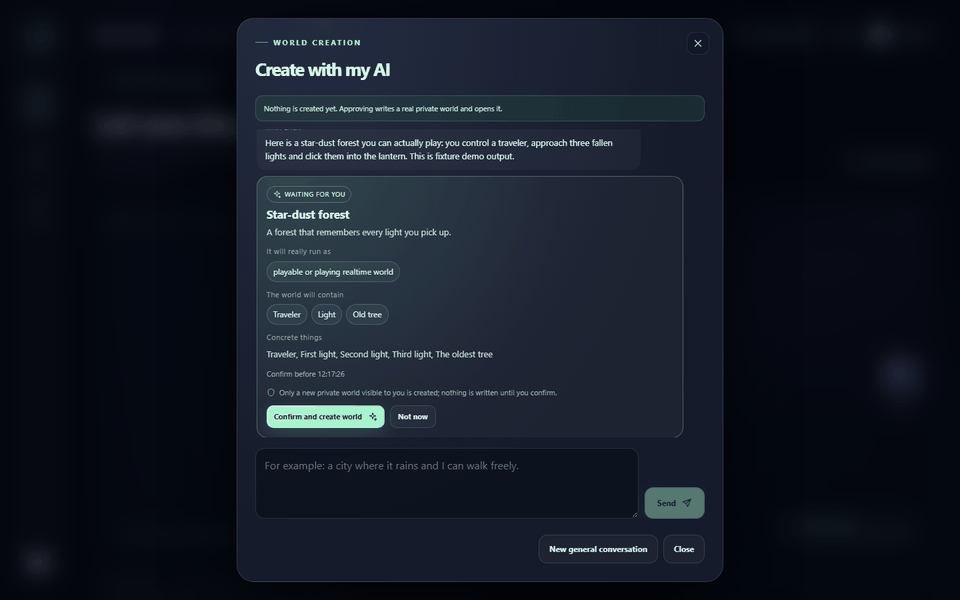
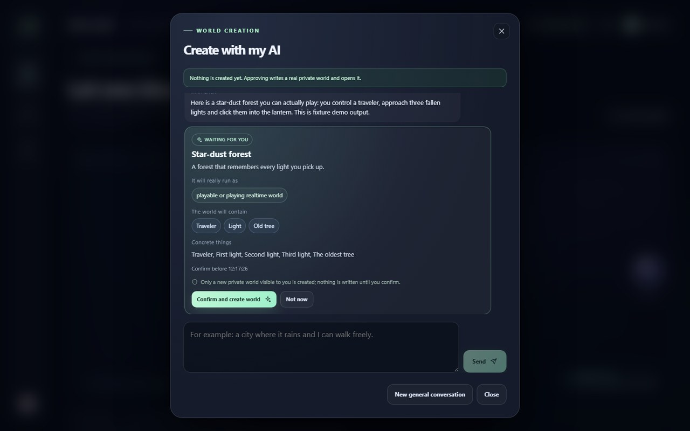
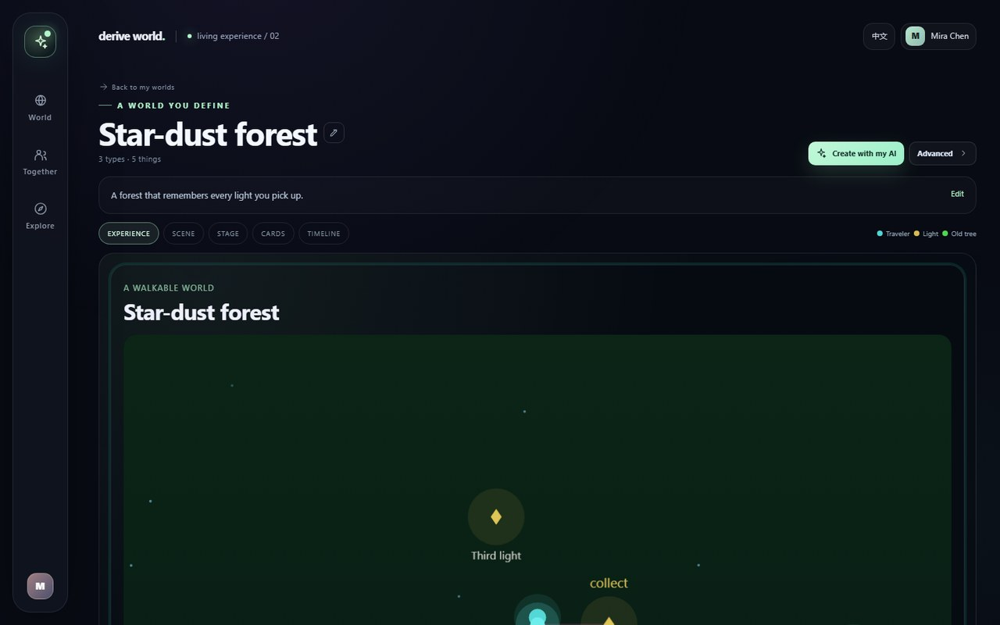
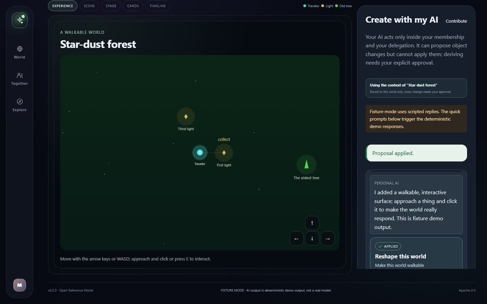
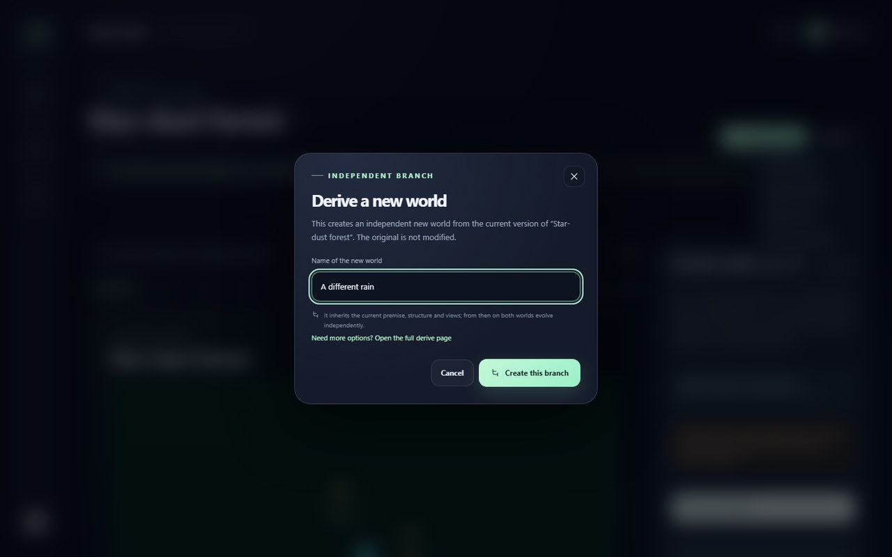
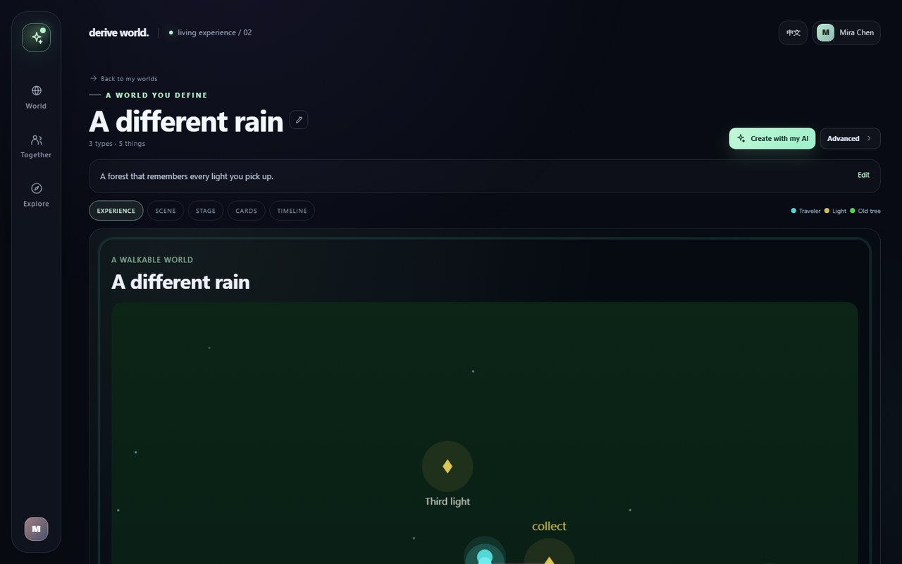

# Showcase — create, change, derive

Derive World is an open-source foundation for **Living Objects**: shared,
versioned worlds that a person and their Personal AI can create, change,
derive from, and trace through an explicit lineage. This page shows the real
`v0.2.0` product and a voluntary, GitHub-native way to share what you build.
The project never collects your worlds, conversations, Handoff projections or
AI context automatically.

## The real v0.2.0 product tour



The [short recording](docs/assets/demo-v02-17s.webm) is a real `v0.2.0`
Fixture session: a newcomer describes a world, approves the plan, enters it,
asks the Personal AI to change it, and derives an independent branch. It runs
in **Fixture mode** — deterministic demo data, no model call, no API key.

The [online product tour](https://qiyanai.github.io/derive-world/showcase/tour/)
adds a clearly labelled interactive simulation and works on desktop and mobile.

## Create → Experience → Change → Derive → Share

### 1. Create with your words



Write what you want to exist. The Personal AI writes a compact world brief;
the server composes a real, runnable world. Nothing is written until you
confirm the plan, and a new world opens as a private world. The plan names the
kinds of things, the concrete things, and the form the world will run as.

### 2. Experience it



The same content can be played, read, operated, watched or explored. A world
can carry a time-based live surface, an interactive story, a workbench, a
visual space, an uploaded image/video, audio, a 3D scene, or a bounded custom
surface — all sharing content, state, variables, permissions, versions and
lineage.

### 3. Change it with your AI



Ask for a change in natural language. The Personal AI can propose a reshape;
the proposal is inert until a human applies it. The applied change increments
the version and is recorded in the world's events. The AI never authorizes
itself.

### 4. Derive a new world





A derive creates an independent child from an immutable snapshot of the
current version. The original world is not modified. The child keeps a recorded
ancestry. Lineage is permission-clipped: objects you cannot read are never
named.
Derivation is at the whole-world level in `v0.2.0`.

### 5. Share only what you choose

- Take the [online product tour](https://qiyanai.github.io/derive-world/showcase/tour/).
- Try the [Derive Relay](examples/worlds/README.md) base world and derive in any direction.
- Submit a public, reproducible world through the
  [showcase issue form](https://github.com/QiyanAI/derive-world/issues/new?template=showcase.yml).

Publication is opt-in and scoped to one instance. There is no cross-instance
federation, no public import and no automatic collection.

## The trust and developer surface

- **Human approval:** AI proposals are inert until a person applies them; a
  derive needs a separate, single-use confirmation bound to a source version.
- **Permissions:** a caller without `read` receives 404; a PAT scope never
  substitutes for object membership.
- **Lineage:** derived worlds are independent; later parent edits do not
  propagate.
- **Open API:** OpenAPI 3.1 at `/api/v1/openapi.yaml`; a typed,
  zero-runtime-dependency TypeScript SDK.
- **Five frozen capabilities:** `object.read`, `object.context`,
  `object.propose_change`, `object.derive`, `content.structure`.
- **Security negatives you can run:** revoked delegation stops the next call; a
  tampered or unsigned provider response is an unknown result; model calls stop
  at configured budgets or the kill switch.
- **Open source:** Apache-2.0; the supported local path is Docker Compose.
  Fixture mode needs no model account.

## Make your own (five steps)

```bash
git clone https://github.com/QiyanAI/derive-world.git
cd derive-world
cp .env.example .env
docker compose up --build -d
```

1. Open <http://127.0.0.1:8080> and create a local account.
2. Click **Create a world** and describe it in one sentence.
3. Approve the plan, then enter the world.
4. Open **Create with my AI** and ask for one change; apply the proposal.
5. Open **Advanced → Derive a new world**, name the branch, and inspect the
   child. The parent stays intact.

Fixture mode needs no model account. For a real model, set `MODEL_MODE=real`
and your own `MODEL_BASE_URL`, `MODEL_NAME` and `MODEL_API_KEY`; your provider
bills you directly. Never commit your key. Real-model evidence is scoped to the
documented flows; Fixture is always labelled and is not real AI.

## Share what you built

Use the **[Showcase submission](https://github.com/QiyanAI/derive-world/issues/new?template=showcase.yml)**
issue form. Tell us:

- what world you made and why;
- how it changed and what you derived;
- how a human and a Personal AI participated;
- a public, reproducible link and the exact version or commit;
- whether it is **Fixture** or **Real AI** (your own endpoint/key);
- what problem it solved, or what integration or example you built.

We link to public, reproducible work. **You do not have to star, share, or
submit anything to use the software.** The project is Apache-2.0.

### Before you submit

- Publish only what you intend to be public.
- Remove private context, conversations, Handoff projections, tokens, personal
  data, and third-party material you cannot share.
- Verify the link works without authentication.
- State the Fixture/Real AI label accurately.
- By opening a public showcase issue, you consent to maintainers linking to it.
  Your content remains yours; Apache-2.0 covers the software, not your work.

The project will **not** automatically collect or publish private worlds,
conversations, Handoff projections, or AI context. `v0.2.0` adds no public
object API, cross-deployment import, or cloud sharing service for the showcase.

## Honest labels

| Label | Meaning |
|---|---|
| **Fixture** | Deterministic demo data. No model is called. Not real AI. |
| **Real AI** | The user configures an OpenAI-compatible endpoint and key, and pays the provider. `v0.2.0` evidence is scoped to the documented flows on DeepSeek `deepseek-flash`. |
| **Not production** | `v0.2.0` is an OSS release. No production readiness, security certification, user adoption, stars, downloads, or funding is claimed. |

See [Limitations](docs/en/limitations.md) for the complete list.

## A note on older assets

Earlier G05 screenshots and recordings remain in `docs/assets/` for historical
reference and release evidence. They are no longer used as the primary
description of the current product. The images and recording on this page were
captured from the running `v0.2.0` product in Fixture mode.
