# The Open Reference World

Derive World `v0.1.0` is a self-hostable reference world for Living Objects. It
is not a marketing site and it is not a mock: every screen below is driven by
the same Go API, PostgreSQL schema, authorization chain, and browser test suite
that ship in this repository.

> **Status:** `v0.1.0` is the first public
> release. Fixture mode is deterministic demo output, not model intelligence.
> Real AI is VERIFIED_REAL only for the approved two-call API-level run (DeepSeek `deepseek-flash`); it was not re-run on the
> release SHA.


## Run it

```bash
git clone https://github.com/QiyanAI/derive-world.git
cd derive-world
cp .env.example .env
docker compose up --build -d
```

Open <http://127.0.0.1:8080>. The header shows `FIXTURE` while the deterministic
adapter is active.

## The five surfaces

| Surface | What it answers |
|---|---|
| **World** | Who am I, which objects do I own or share, what is waiting for me, and how are things connected? |
| **Objects** | Which Living Objects can I read, and what is my role in each? |
| **Personal AI** | What does my AI know privately, which conversations exist, and what can it receive from an object? |
| **Digital Self** | What authorizations did I grant, what can I revoke, and which actions need my approval? |
| **Settings** | Language, tokens, data export, deployment mode, and documented limits. |

### First use

Registration creates the user, Personal AI profile, empty private context, and
default delegation in one transaction. The welcome page reflects that real
state; it does not create sample data behind your back.

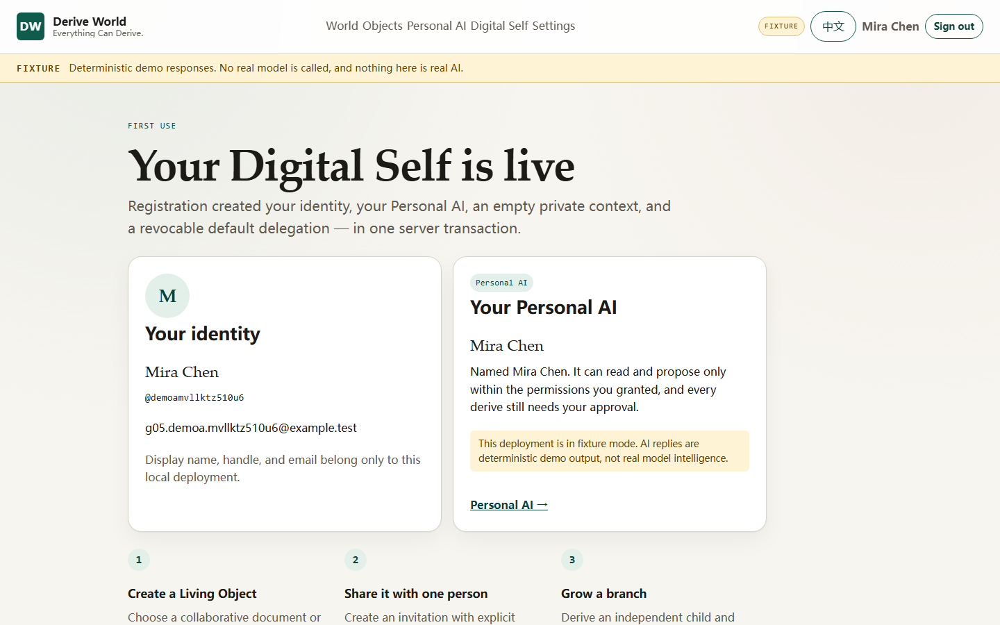

The World page marks each onboarding step from server state, not from a local
flag: an object exists, a member joined, a conversation exists, or a derivation
edge exists.


## Two real object experiences

### Collaborative object

A document with summary, body, checklist, and tags. Editing is a versioned
action; the server checks `expected_version` and never overwrites silently.
Checklist toggles and tags are separate actions with their own events.

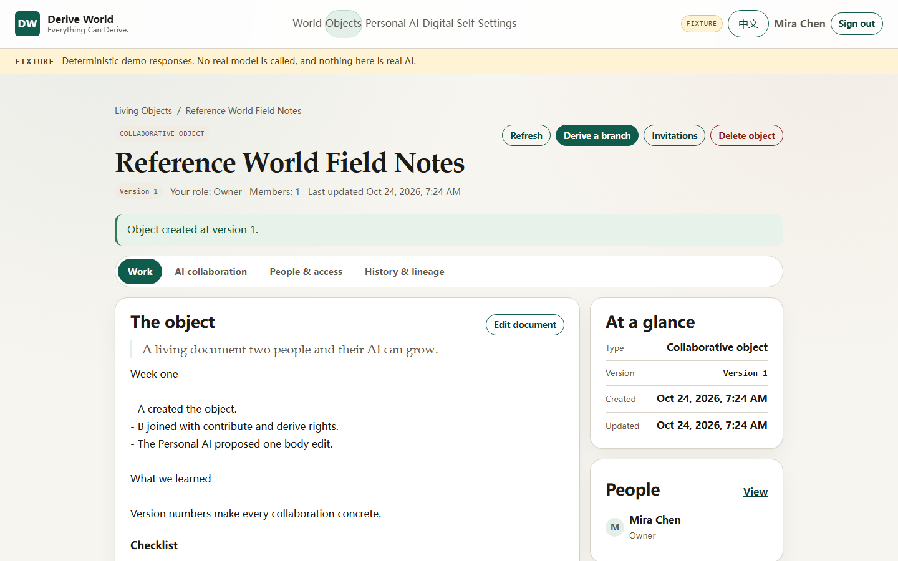

### Interactive object

A prompt with 2–10 options. Members vote, a second vote moves the receipt, the
owner closes the poll, and voting after close is rejected by the server.

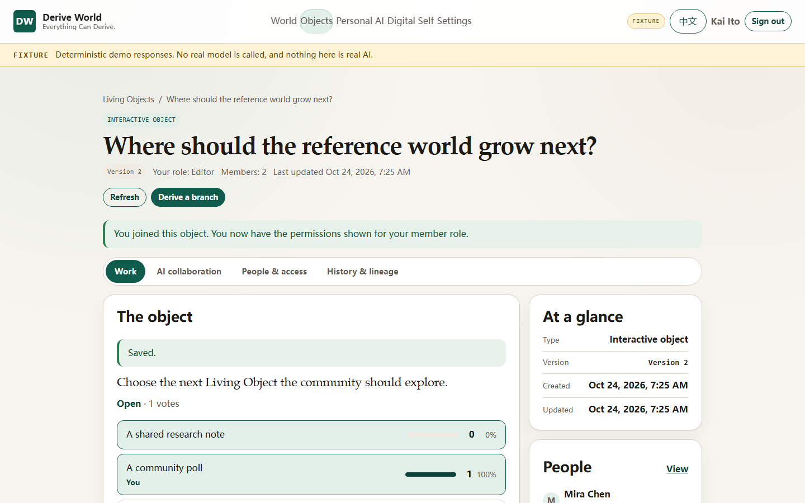

## Invite and join

An invitation grants an explicit permission set: read, contribute, derive, or
invite. The link is shown once; only its digest is stored. A new person can
create an account from the invitation and return to the same link, because the
`next` route survives registration.

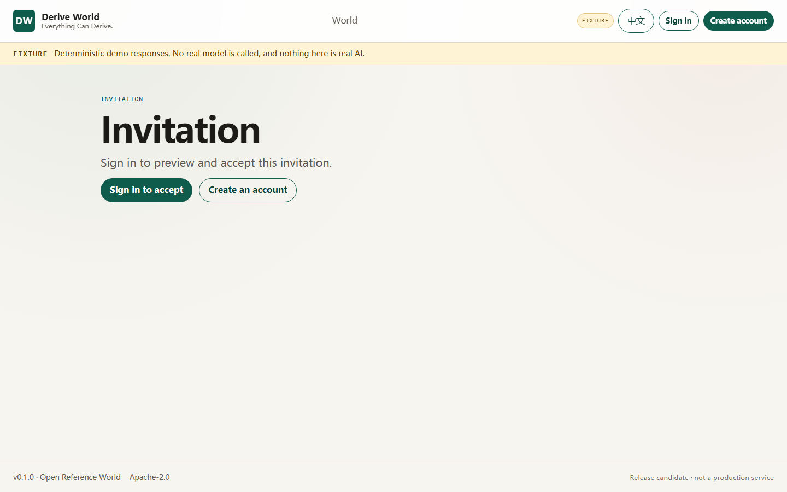

Removing a member or revoking an invitation takes effect on the next request.
The open workspace transitions to an access-lost state instead of continuing to
render cached content.

## Handoff, proposal, confirmation, derive

The Personal AI never receives the database. The server builds a bounded,
read-only Handoff from the intersection of your membership and your active
delegation. The preview in **People & access** shows the membership-level
projection and states that the AI is further limited by your delegation.

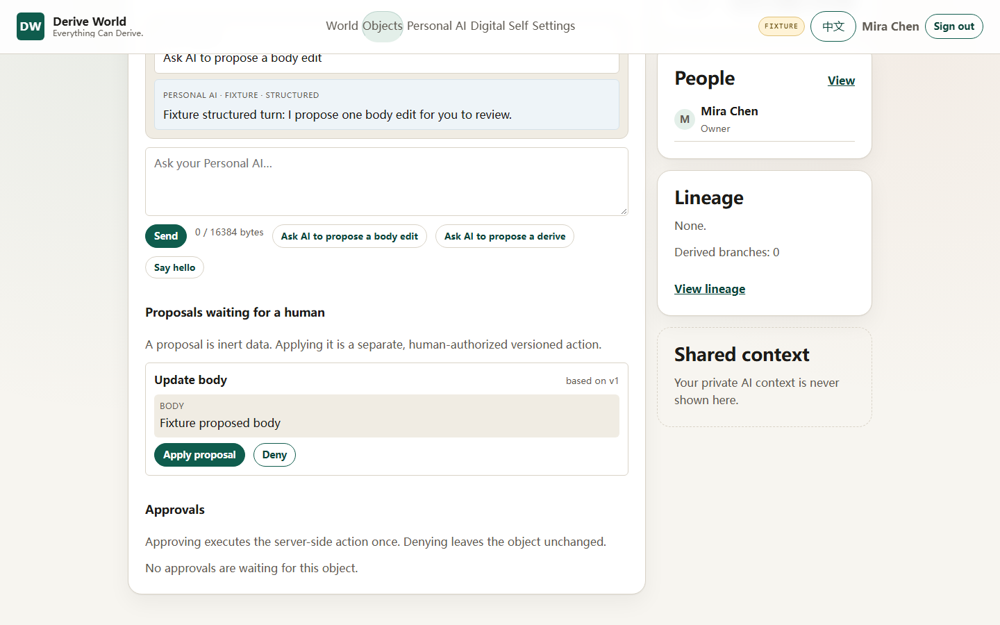

In fixture mode, the scripted prompts create one structured action at a time:
a body proposal, or a derive request. The proposal is inert data until a human
applies it. The derive request is a server-created confirmation bound to the
object version at request time.

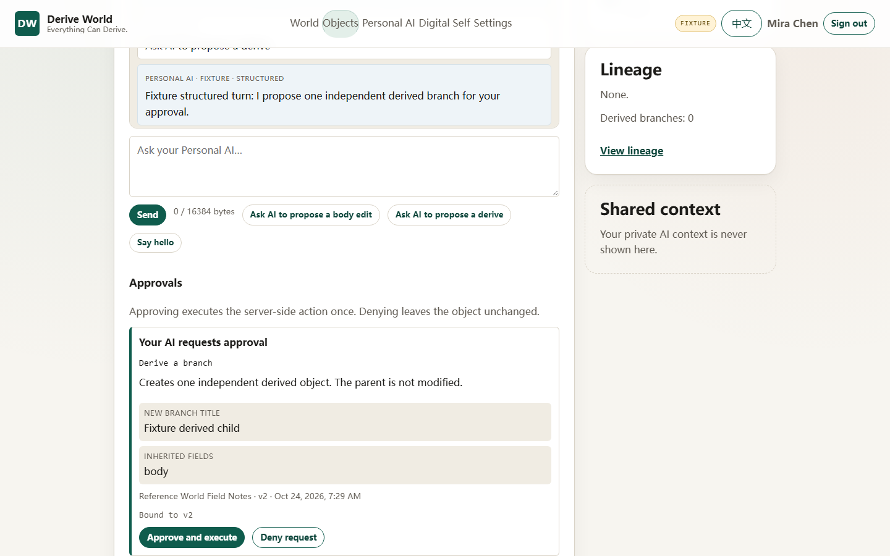

Approving executes the action once on the server. The UI shows the created
object and links to it; denying leaves the object unchanged. A stale bound
version is flagged before approval and is refused with `version_conflict` if it
changes underneath you.

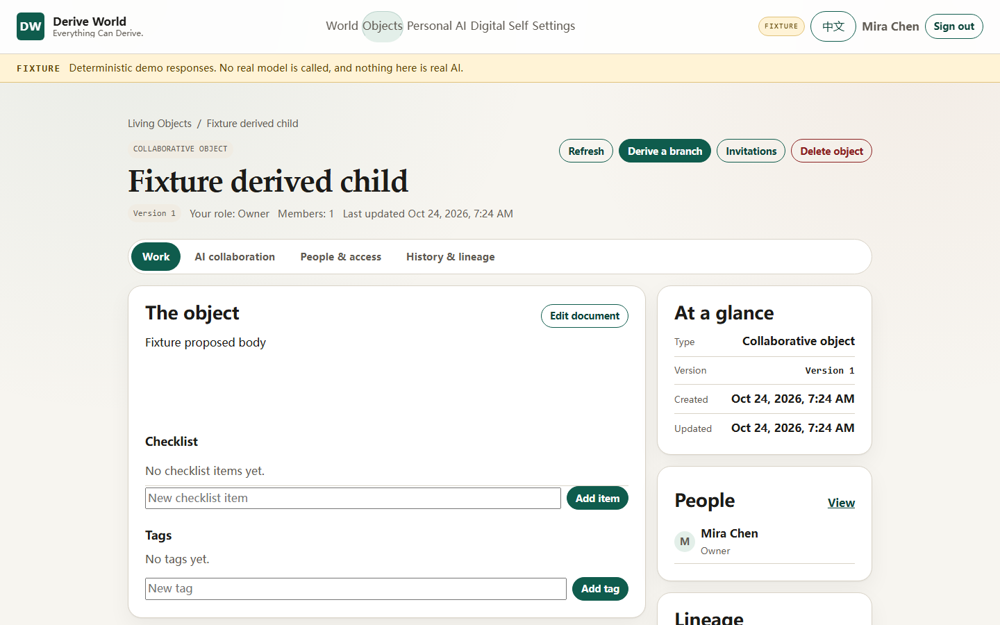

## History, lineage, and privacy clipping

The History tab groups events by object version, humanizes actions, and links
each version to a derive-from-that-version flow. The event payload stays
available behind progressive disclosure.

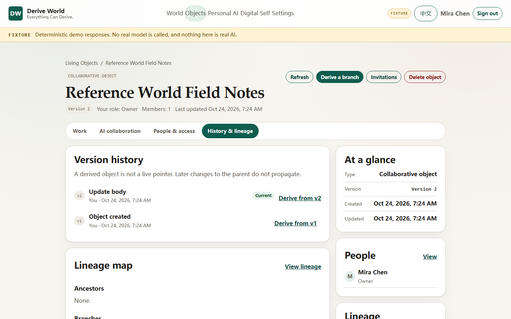

Lineage is bounded and clipped by what the viewer may read. An unreadable
ancestor is shown as a hidden node; an unreadable descendant is omitted. The UI
never claims "no branches exist" when it can only know that none are visible.

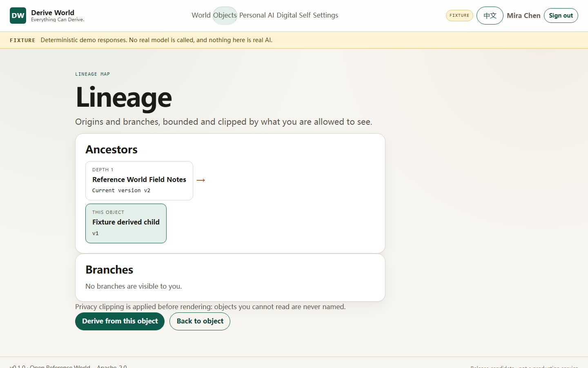

## Honest failures

The client maps the closed API error set to localized explanations, keeps the
request ID in technical details, and offers retry where retry is meaningful.
Version conflicts, revoked access, expired confirmations, capacity limits,
model/capability failures, and service unavailability are distinct states. A
failed request is never rendered with a success notice.

## English, Chinese, and mobile

The full interface has English and Chinese message catalogs with type-enforced
key parity. Language changes update `<html lang>`, route titles, and every
surface without a reload.

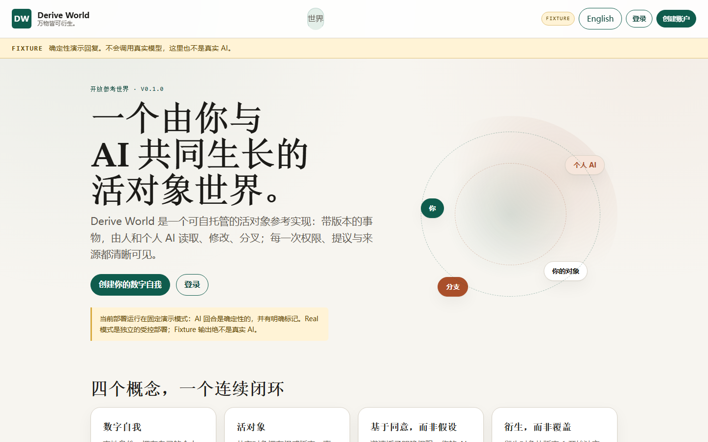

At 390 px the header becomes a scrollable navigation, object sections remain
reachable, lineage indentation is capped, and the Playwright suite asserts that
`scrollWidth` never exceeds the viewport.

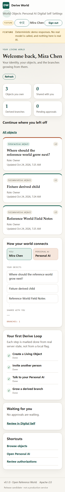

## What is deliberately not here

- Real model calls in the deterministic fixture demo; Real AI is a separate
  controlled mode, verified only for the approved two-call run.
- Real-time collaboration; the workspace polls while visible.
- Email, password recovery, OAuth, or account deletion.
- A hosted service, payment system, agent market, or third implementation of
  identity, objects, permissions, derivation, or confirmations.

See [Demo guide](demo-guide.md) for the two-user walkthrough and
[Limitations](limitations.md) for the current boundaries.
