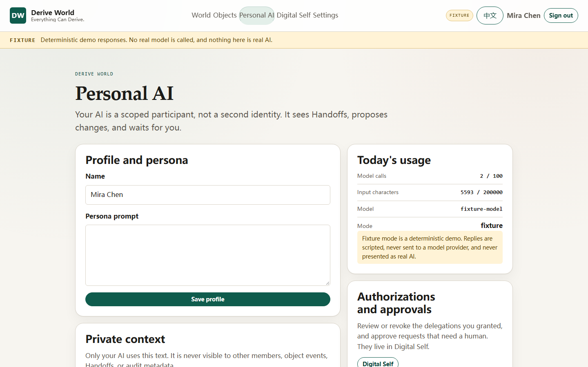

# 作品展示与分享

Derive World 是 **Living Object** 的基础：共享、有版本的对象，人和自己的 Personal AI 可以读取、贡献、衍生，并沿着显式来源链追溯。本页是首发作品展示，也是 GitHub 原生的自愿分享入口。项目没有独立社区平台，也不会自动采集你的对象、会话、Handoff 投影或 AI 上下文。

## 17 秒演示


[完整录屏](../assets/demo-17s.webm) 是 17 秒参考世界演示：Living Object、版本历史与来源链、互动投票。它运行在 **Fixture 模式**——确定性演示数据，不调用模型，不需要 API Key。

## 三个角度

### 1. Living Object 保留历史，并可以衍生


Living Object 是版本化协作文档或互动投票。每次被接受的操作都会产生版本。**Derive** 从源的不可变快照创建独立子对象：之后对父对象的修改不会传播，子对象也不继承成员、投票或私人数据。来源链按权限裁剪——你无权读取的对象永远不会被命名。

**试一试：** 创建协作文档，编辑两次；分别从 v1 与 v2 各衍生一个子对象；打开 **History & lineage** 对比祖先关系。见[参考世界指南](reference-world.md)。

### 2. Human + Personal AI + Human




两名独立用户、各自的 Personal AI、共享对象。Handoff 是只读投影：不携带私人上下文、会话、令牌或其他成员的委托。接收方的 Personal AI 可以提议修改或衍生。提议在人类应用前是惰性的；衍生还需要单独的、绑定对象版本的五分钟单次人类确认。**AI 永远不会自我授权。**

**试一试：** 用两个浏览器配置，邀请第二个人，打开 **AI collaboration**，应用一个提议，再批准一次衍生并查看新的子对象。见[双人演示指南](demo-guide.md)。

**准确标签：** 这些截图与演示是 **Fixture 模式**——确定性演示输出，不是真实模型智能。`v0.1.0` 中唯一的 Real AI 验收证据是已批准的双 Personal AI 两次 API 级 DeepSeek `deepseek-flash` 调用。它不是浏览器演示，未在发布 SHA 上重跑，也不构成普遍 Provider 声明。

### 3. 安全、可复现的开源基础

- **Open API：** OpenAPI 3.1 位于 `/api/v1/openapi.yaml`；[API 指南](api.md)记录公开契约。
- **TypeScript SDK：** 类型化、零运行时依赖，用于 PAT 授权的能力列表/详情/调用与 invocation 查询。
- **五项冻结能力**经单一 Broker：`object.read`、`object.context`、`object.propose_change`、`object.derive`、`content.structure`。
- **可运行的安全负例：** 无 `read` 的调用者收到 404；撤销委托后下一次调用立即失效；PAT scope 不能替代对象成员关系；被篡改或未签名的 Provider 响应视为未知结果；模型调用在预算或停止开关处停止。
- **复现检查：**

  ```bash
  gofmt -l .
  go vet ./...
  go test ./...
  npm ci
  npm run typecheck
  npm run build
  docker compose up --build -d
  npm run test:e2e
  ```

- **验证发行：** `SHA256SUMS` 覆盖全部资产；发布工作流生成 GitHub OIDC/Sigstore 构建来源证明。使用 `gh attestation verify`，命令见[发行说明](release-notes.md#验证)。

## 做出你的作品（五步）

```bash
git clone https://github.com/QiyanAI/derive-world.git
cd derive-world
cp .env.example .env
docker compose up --build -d
```

1. 打开 <http://127.0.0.1:8080>，创建本地账号。
2. 创建协作文档或互动投票。
3. 在 **People & access** 邀请第二个人。
4. 打开 **AI collaboration**，应用脚本化提议，再批准一次衍生。
5. 打开 **History & lineage**，查看子对象的祖先关系。

Fixture 模式不需要模型账户。若要真实模型，设置 `MODEL_MODE=real` 与你自己的 `MODEL_BASE_URL`、`MODEL_NAME`、`MODEL_API_KEY`；费用由你的 Provider 直接计费。绝不要提交你的 Key。

## 分享你的作品

使用 **[Showcase submission](https://github.com/QiyanAI/derive-world/issues/new?template=showcase.yml)** Issue 表单，告诉我们：

- 你做了什么 Living Object，为什么做；
- 你建立了怎样的衍生关系或来源链；
- 人类与 Personal AI 如何参与；
- 公开、可复现的链接与准确版本或 Commit；
- 它是 **Fixture** 还是 **Real AI**（你自己的端点/Key）；
- 它解决了什么问题，或你构建了什么集成/示例。

我们会链接公开、可复现的作品。**你不必 Star、转发或提交任何内容才能使用本软件。** 项目采用 Apache-2.0。

### 提交前

- 只发布你希望公开的内容。
- 移除私人上下文、会话、Handoff 投影、令牌、个人信息，以及你无权分享的第三方素材。
- 确认链接无需登录即可访问。
- 准确标注 Fixture/Real AI。
- 打开公开 Showcase Issue 即表示你同意维护者从项目链接到该 Issue。内容仍归你所有；仓库的 Apache-2.0 只覆盖软件，不覆盖你的投稿。

项目**不会**自动采集或发布私人对象、会话、Handoff 投影或 AI 上下文。`v0.1.0` 不为展示新增公开对象 API、跨部署导入或云分享服务。

## 诚实标签

| 标签 | 含义 |
|---|---|
| **Fixture** | 确定性演示数据，不调用模型，不是真实 AI。 |
| **Real AI** | 用户配置 OpenAI-compatible 端点与 Key，并自行承担 Provider 费用。`v0.1.0` 的验收证据是上述限定的两轮 API 级调用。 |
| **非生产** | `v0.1.0` 是 OSS MVP。不声称生产就绪、安全认证、用户采用、Star、下载量或融资。 |

完整限制见[限制](limitations.md)。
