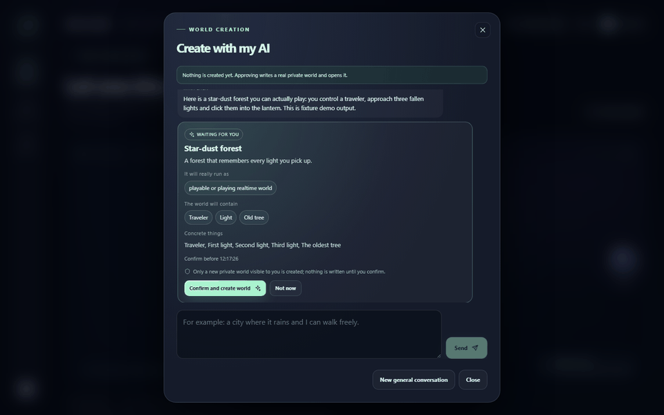
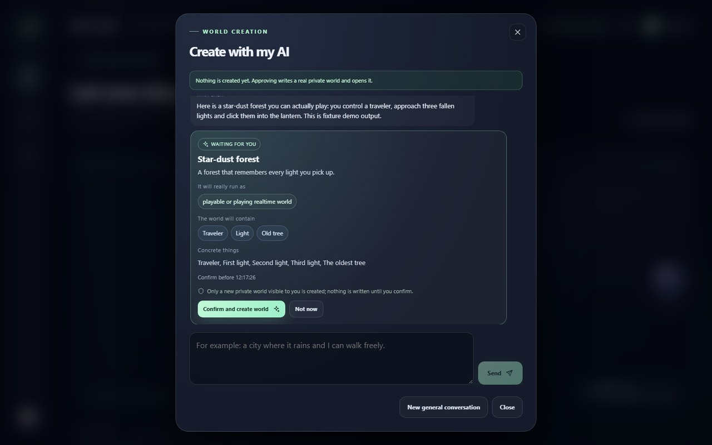
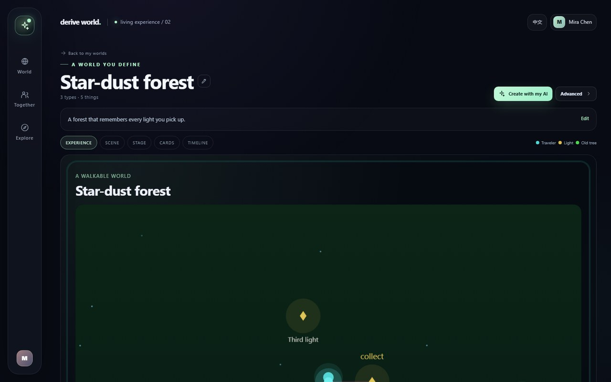
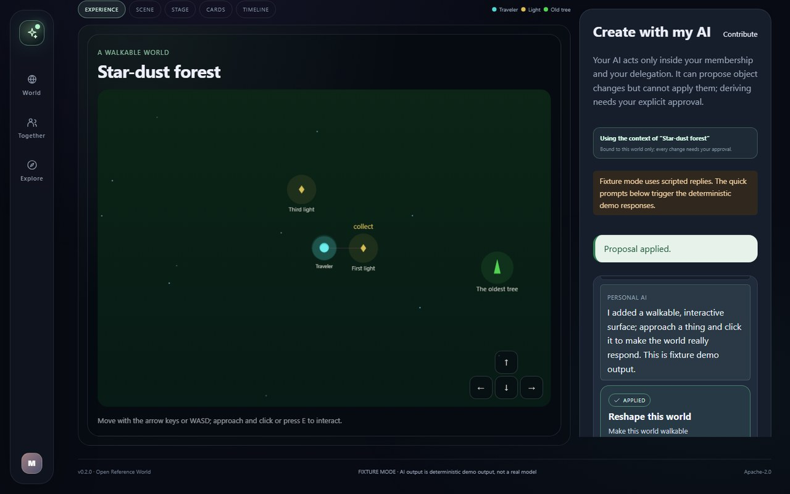
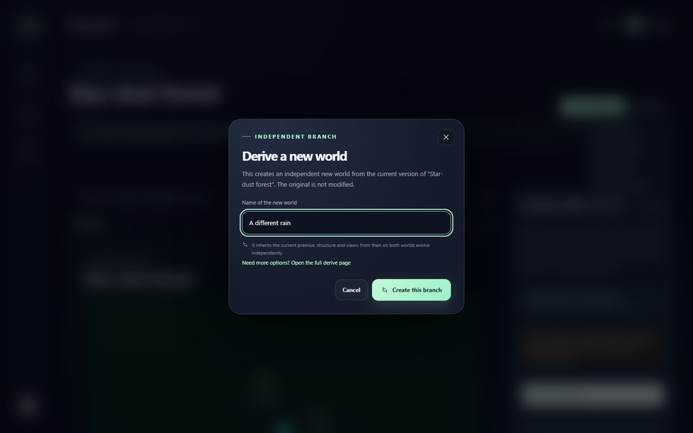
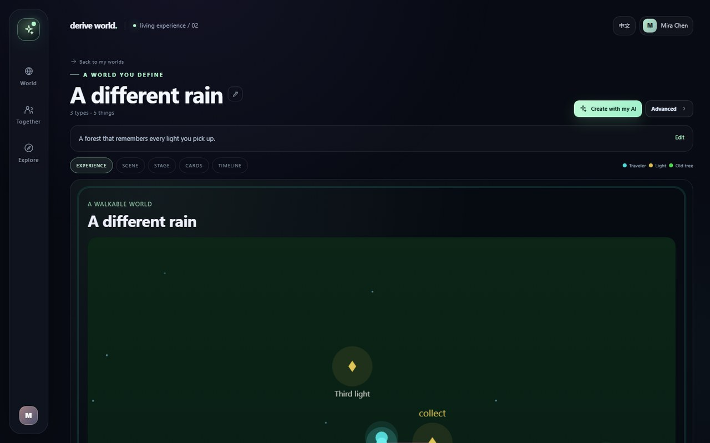

# 作品展示与分享

Derive World 是 **Living Object（活对象）** 的开源基础：共享、有版本的世界，人和自己的 Personal AI 可以创造、修改、衍生，并沿显式来源链追溯。本页展示真实 `v0.2.0` 产品，并提供 GitHub 原生的自愿分享入口。项目不会自动采集你的世界、会话、Handoff 投影或 AI 上下文。

## v0.2.0 真实产品演示



[短视频](../assets/demo-v02-17s.webm) 是真实 `v0.2.0` Fixture 会话：新用户描述世界、批准计划、进入世界、让 Personal AI 修改，再衍生独立分支。它运行在 **Fixture 模式**——确定性演示数据，不调用模型，不需要 API Key。

[在线产品导览](https://qiyanai.github.io/derive-world/showcase/tour/) 还提供明确标注的交互模拟，桌面和手机均可浏览。

## Create → Experience → Change → Derive → Share

### 1. 用自己的话创造



写下你想要的世界。Personal AI 写出一份紧凑的世界种子，服务器工坊将其展开为真正可运行的世界。在你确认计划前不会写入任何内容；新世界以私人世界打开，并明确列出世界的种类、具体存在和运行形式。

### 2. 进入并体验



同一份内容可以被游玩、阅读、操作、观看或三维探索。一个世界可以组合实时表面、互动故事、工作台、可视空间、上传图像/视频、音频、三维场景或受控自定义表面——它们共享内容、状态、变量、权限、版本与来源链。

### 3. 与 AI 一起修改



用自然语言提出修改。Personal AI 可以提议重塑世界，但提议在人类应用前是惰性的。应用后版本递增，并记录到世界事件中。**AI 永远不会自我授权。**

### 4. 衍生一个新世界





Derive 从当前版本的不可变快照创建独立子世界；原世界不会被修改。子世界保留来源链，并按权限裁剪——你无权读取的对象永远不会被命名。`v0.2.0` 的衍生粒度是整个世界。

### 5. 只分享你选择公开的内容

- 打开[在线产品导览](https://qiyanai.github.io/derive-world/showcase/tour/)。
- 从 [Derive Relay](../../examples/worlds/README.md) 的基础世界出发，自由衍生。
- 通过 [Showcase 投稿表单](https://github.com/QiyanAI/derive-world/issues/new?template=showcase.yml) 提交公开、可复现的世界。

公开是主动选择，且限定在单实例内。不存在跨实例联邦、公开导入或自动采集。

## 安全与开发者能力

- **人类审批：** AI 提议必须由人应用；衍生需要单独的、绑定源版本的单次确认。
- **权限：** 无 `read` 权限的调用者收到 404；PAT scope 不能替代对象成员关系。
- **来源链：** 衍生世界独立，父对象的后续修改不会传播。
- **Open API：** OpenAPI 3.1 位于 `/api/v1/openapi.yaml`；TypeScript SDK 零运行时依赖。
- **五项冻结能力：** `object.read`、`object.context`、`object.propose_change`、`object.derive`、`content.structure`。
- **可运行的安全负例：** 撤销委托后下一次调用失效；被篡改或未签名的 Provider 响应视为未知结果；模型调用在预算或停止开关处停止。
- **开源：** Apache-2.0；受支持的本地路径是 Docker Compose，Fixture 模式不需要模型账户。

## 做出你的作品（五步）

```bash
git clone https://github.com/QiyanAI/derive-world.git
cd derive-world
cp .env.example .env
docker compose up --build -d
```

1. 打开 <http://127.0.0.1:8080>，创建本地账号。
2. 点击 **Create a world**，用一句话描述世界。
3. 批准计划并进入世界。
4. 打开 **Create with my AI**，提出一次修改并应用提议。
5. 打开 **Advanced → Derive a new world**，命名分支并查看子世界；父世界保持不变。

Fixture 模式不需要模型账户。若要真实模型，设置 `MODEL_MODE=real` 与你自己的 `MODEL_BASE_URL`、`MODEL_NAME`、`MODEL_API_KEY`；费用由你的 Provider 直接计费。绝不要提交 Key。真实模型证据有明确范围；Fixture 始终标注，且不是真实 AI。

## 分享你的作品

使用 **[Showcase 投稿](https://github.com/QiyanAI/derive-world/issues/new?template=showcase.yml)** Issue 表单，告诉我们：

- 你做了什么世界，为什么做；
- 它如何被修改、你衍生出了什么；
- 人类与 Personal AI 如何参与；
- 公开、可复现的链接与准确版本或 Commit；
- 它是 **Fixture** 还是 **Real AI**（你自己的端点/Key）；
- 它解决了什么问题，或你构建了什么集成/示例。

我们会链接公开、可复现的作品。**你不必 Star、转发或提交任何内容才能使用本软件。** 项目采用 Apache-2.0。

### 提交前

- 只发布你希望公开的内容。
- 移除私人上下文、会话、Handoff 投影、令牌、个人信息，以及你无权分享的第三方素材。
- 确认链接无需登录即可访问。
- 准确标注 Fixture/Real AI。
- 打开公开 Showcase Issue 即表示你同意维护者从项目链接到该 Issue。内容仍归你所有；Apache-2.0 只覆盖软件，不覆盖你的投稿。

项目**不会**自动采集或发布私人世界、会话、Handoff 投影或 AI 上下文。`v0.2.0` 不为展示新增公开对象 API、跨部署导入或云分享服务。

## 诚实标签

| 标签 | 含义 |
|---|---|
| **Fixture** | 确定性演示数据，不调用模型，不是真实 AI。 |
| **Real AI** | 用户配置 OpenAI-compatible 端点与 Key，并自行承担 Provider 费用。`v0.2.0` 的证据是 DeepSeek `deepseek-flash` 上有范围的真实模型流程。 |
| **非生产** | `v0.2.0` 是 OSS 发行版。不声称生产就绪、安全认证、用户采用、Star、下载量或融资。 |

完整限制见[限制](limitations.md)。

## 旧版素材说明

早期 G05 截图与录屏保留在 `docs/assets/` 中，用于历史记录与发行证据，不再作为当前产品的主要宣传画面。本页图片与录屏来自运行中的 `v0.2.0` 产品（Fixture 模式）。
